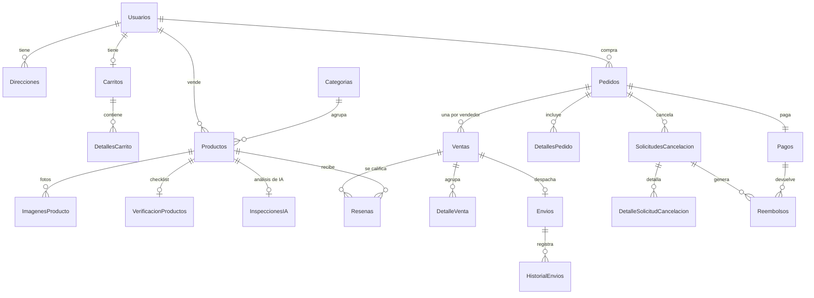

# Base de datos

SQL Server Express. Los scripts están en `scripts/` y se ejecutan en SSMS en este orden:

| Orden | Script | Qué hace | ¿Repetible? |
|---|---|---|---|
| 1 | `00_modelo.sql` | Crea la base `ElectroMarket` y todas las tablas del modelo | No (instalación nueva) |
| 2 | `01_perfil_usuarios.sql` | Agrega `FechaNacimiento` y `Genero` a `Usuarios` si faltan | Sí |
| 3 | `02_reembolsos.sql` | Agrega `FechaSolicitud` y `Referencia` a `Reembolsos` | Sí |
| 4 | `03_verificacion_productos.sql` | Crea `VerificacionProductos` (checklist de estado) | Sí |
| 5 | `04_datos_iniciales.sql` | Inserta las categorías de productos | Sí |
| 6 | `05_inspeccion_ia.sql` | Crea `InspeccionesIA` (resultado del inspector de estado con IA) | Sí |
| 7 | `06_resenas.sql` | Crea `Resenas` (calificaciones de producto y vendedor por venta entregada) | Sí |
| 8 | `99_verificar_esquema.sql` | Solo lectura: comprueba estados `CHECK` y columnas que usa el código | Sí |

Si ya tienes la base creada, omite `00_modelo.sql` y ejecuta del 01 en adelante. Si las consultas de `99_verificar_esquema.sql` salen vacías, el esquema es compatible con la aplicación.

## Modelo

## Estados

| Tabla | Estados |
|---|---|
| `Pedidos` | `PENDIENTE_PAGO`, `PAGADO`, `EN_PROCESO`, `PARCIALMENTE_ENVIADO`, `COMPLETADO`, `CANCELADO` |
| `Pagos` | `PENDIENTE`, `APROBADO`, `RECHAZADO`, `REEMBOLSO_PARCIAL`, `REEMBOLSADO` |
| `Ventas` | `PENDIENTE`, `PREPARANDO`, `ENVIADA`, `ENTREGADA`, `CANCELACION_SOLICITADA`, `CANCELADA` |
| `Envios` | `PREPARANDO`, `ENVIADO`, `EN_TRANSITO`, `ENTREGADO`, `PROBLEMA`, `CANCELADO` |
| `SolicitudesCancelacion` | `PENDIENTE` (la API la muestra como `SOLICITADA`), `APROBADA`, `RECHAZADA` |
| `Reembolsos` | `PENDIENTE`, `PROCESADO` |
| `Productos` | `PUBLICADO`, `PAUSADO`, `AGOTADO`, `ELIMINADO` |
| `InspeccionesIA.Coherencia` | `COHERENTE`, `REVISAR` (un producto en `REVISAR` no puede quedar verificado) |

`HistorialEstados` guarda los cambios de estado de pedidos y ventas; `HistorialEnvios`, los de envíos.

## Reglas que impone el esquema

- `SolicitudesCancelacion.TipoSolicitud`: `TOTAL` solo sin `IdVenta` y `PARCIAL` solo con `IdVenta`. El código guarda una solicitud por venta (`PARCIAL`) y la API calcula si fue total o parcial.
- Un pago por pedido (`UQ_Pagos_Pedido`) y una venta por vendedor en cada pedido (`UQ_Pedido_Vendedor`).
- Una reseña por producto en cada venta (`UQ_Resenas_Venta_Producto`), con estrellas de 1 a 5 (`CHECK`); el backend exige que la venta esté entregada y que quien reseña sea el comprador.
- Una sola foto principal por producto (índice filtrado `UX_Imagen_Principal`).
