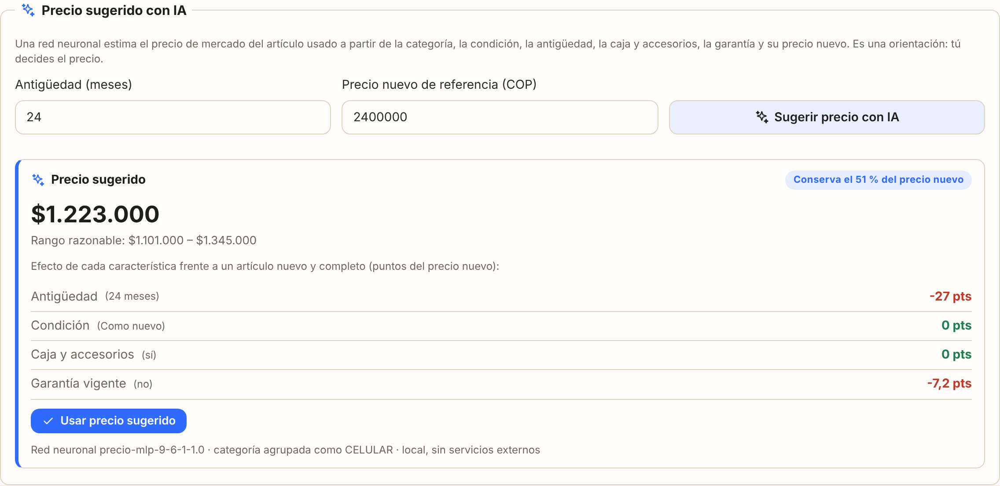
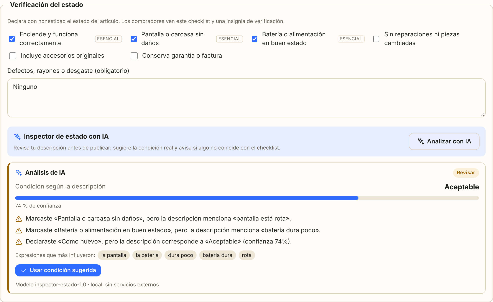
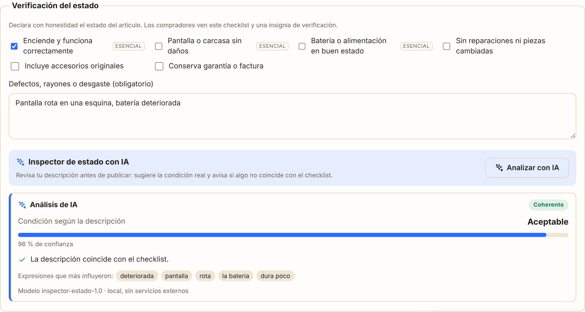
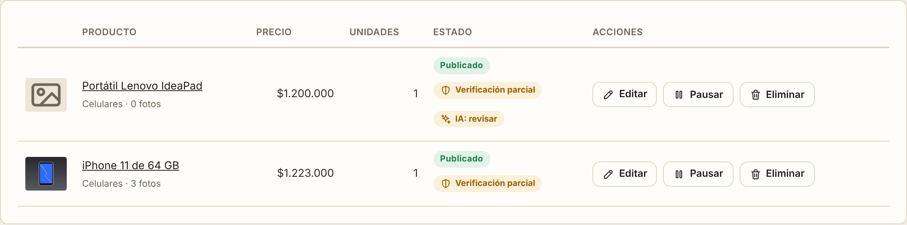
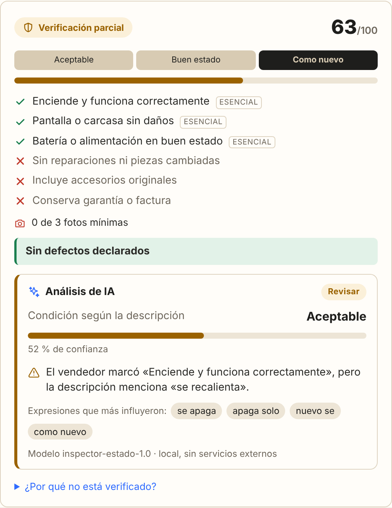

# Entrega final: Prototipo, pruebas y servicio de IA

**ElectroMarket**: sistema transaccional de compraventa de electrónicos usados, con dos servicios de IA (precio sugerido con red neuronal e inspector de estado). Equipo: Alejandro Castro Alvarez, Maria Camila Sosa Cediel y Manuel Santiago Osorio Feo.

## 1. Enlace o acceso al prototipo

- **Repositorio:** https://github.com/alejo7762-coder/ElectroMarket
- **Instalación y ejecución local:** sección «Instalación» del [README](../README.md), con estos pasos:
  1. `pip install -r backend/requirements.txt`
  2. Ejecutar en SSMS los scripts de `database/scripts/` (00 a 05 y 99), según [`database/README.md`](../database/README.md).
  3. Copiar `backend/.env.example` como `backend/.env` y completarlo.
  4. `cd backend` y `uvicorn app.main:app --reload`.
  5. Abrir http://127.0.0.1:8000 (tienda) y http://127.0.0.1:8000/docs (API).
  6. Opcional: `python -m scripts.datos_demo` crea usuarios y productos de demostración.

## 2. Evidencias de las pruebas

Índice: [`evidencias/pruebas/RESUMEN.md`](evidencias/pruebas/RESUMEN.md)

- 116 pruebas automatizadas, todas aprobadas; 4 de ellas recorren el sistema contra SQL Server real.
- Reporte HTML de pytest: [`evidencias/pruebas/reporte_pruebas.html`](evidencias/pruebas/reporte_pruebas.html)
- Cobertura del backend: 66 % ([`salida_pytest.txt`](evidencias/pruebas/salida_pytest.txt))
- Pruebas de interfaz en navegador real con capturas: [`evidencias/capturas/`](evidencias/capturas/)

## 3. Evidencia del servicio de Inteligencia Artificial

Documento: [`SERVICIO_IA.md`](SERVICIO_IA.md) (problema, integración, información que procesa, resultado y uso de cada servicio).

- Precio sugerido: red neuronal 9-6-1 con R² de 0,968, mejor que la regresión lineal y el bosque aleatorio ([`evidencias/ia/metricas_precio.md`](evidencias/ia/metricas_precio.md)).
- Inspector de estado, métricas del modelo: [`evidencias/ia/metricas_modelo.md`](evidencias/ia/metricas_modelo.md). Exactitud del 94,4 % con descripciones escritas a mano que el modelo nunca vio; 5 de 5 inconsistencias detectadas.
- Capturas del servicio en funcionamiento:

| Captura | Muestra |
|---|---|
|  | La red neuronal sugiere el precio, el rango y el efecto de cada característica |
|  | El vendedor analiza un borrador incoherente: la IA sugiere «Aceptable» y lista las contradicciones |
|  | Tras corregir el checklist y la descripción, el análisis es coherente |
|  | La publicación incoherente aparece con «IA: revisar» y sin «Estado verificado» |
|  | El comprador ve el análisis de IA en la ficha del producto |

- API: `POST /productos/precio-sugerido`, `POST /ia/inspeccionar` y `GET /ia/modelo` (versión, descripción y métricas de ambos servicios).

## 4. Documento Maestro

Versión final consolidada: [`Documento_Maestro_Sistemas_Transaccionales_ElectroMarket_Castro_Sosa_Osorio.pdf`](Documento_Maestro_Sistemas_Transaccionales_ElectroMarket_Castro_Sosa_Osorio.pdf) (y su versión editable `.docx`).

## 5. Guion de la presentación

Ver [`SUSTENTACION.md`](SUSTENTACION.md): demostración del prototipo, de las pruebas y del servicio de IA, con las preguntas probables.
