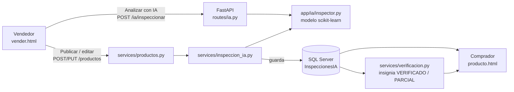

# Servicio de Inteligencia Artificial: Inspector de estado

ElectroMarket vende electrónicos **usados**. El mayor riesgo para el comprador es recibir un producto en peor estado del que se anunció. El inspector de estado es un modelo de IA propio que lee cada publicación y avisa cuando la descripción no coincide con lo que declara el vendedor.

## 1. ¿Qué problema resuelve?

El vendedor elige la condición (Como nuevo, Buen estado o Aceptable) y marca un checklist (enciende, pantalla sin daños, batería en buen estado…). Nada impedía declarar «Como nuevo» y escribir «la pantalla está rota» en la descripción. El inspector:

- **Sugiere la condición real** a partir del texto, con un nivel de confianza.
- **Detecta inconsistencias** entre la descripción y el checklist o la condición declarada.
- **Explica** su resultado con las expresiones del texto que más influyeron.

## 2. ¿Cómo se integra?



| Pieza | Archivo | Función |
|---|---|---|
| Modelo | `backend/app/ia/inspector.py` | Clasificación, coherencia y explicación |
| Datos | `backend/app/ia/datos/` | Entrenamiento (sintético) y evaluación (escrita a mano) |
| Entrenamiento y métricas | `backend/app/ia/evaluar.py` | Entrena, evalúa y genera `docs/evidencias/ia/` |
| API | `backend/app/routes/ia.py` | `POST /ia/inspeccionar` (vista previa) y `GET /ia/modelo` (información y métricas) |
| Persistencia | `backend/app/services/inspeccion_ia.py` | Guarda y lee el análisis en `InspeccionesIA` |
| Tabla | `database/scripts/05_inspeccion_ia.sql` | Resultado por producto |
| Interfaz | `frontend/js/vender.js`, `producto.js`, `api.js` (`panelIA`) | Botón «Analizar con IA», panel del análisis y alerta «IA: revisar» |

El modelo se ejecuta **dentro del backend**, sin servicios externos, sin costo y sin internet. Se entrena automáticamente la primera vez (unos segundos). Si la IA fallara, la publicación sigue adelante y el error queda en el log: la IA ayuda, pero no bloquea la venta.

## 3. ¿Qué información procesa?

| Entrada | Uso |
|---|---|
| Título y descripción | Texto que lee el modelo |
| Defectos declarados | Texto que lee el modelo (se ignora «Ninguno», porque es una afirmación del vendedor y no una evidencia) |
| Checklist del vendedor | Se compara con lo que dice el texto |
| Condición declarada | Se compara con la condición que sugiere el modelo |

No procesa datos personales ni fotos.

**Cómo funciona por dentro:**

1. **Normalización:** minúsculas y sin tildes («Batería» = «bateria»).
2. **Características (TF-IDF):** palabras y pares de palabras («pantalla rota», «como nuevo»), más fragmentos de 3 a 5 letras, que toleran errores de escritura.
3. **Clasificador:** regresión logística multiclase (scikit-learn) que da la probabilidad de cada condición.
4. **Reglas de coherencia:** expresiones que contradicen cada punto del checklist («pantalla rota», «batería dura poco», «le cambiaron la pantalla»…). Respetan las negaciones: «sin golpes» no es una contradicción.

## 4. ¿Qué resultado genera?

Salida real para «iPhone 11 como nuevo. La pantalla está rota en una esquina y la batería dura poco, pero funciona.», declarado «Como nuevo» con el checklist completo:

```json
{
  "condicion_sugerida": "ACEPTABLE",
  "confianza": 0.7352,
  "probabilidades": {
    "ACEPTABLE": 0.7352,
    "BUENO": 0.0759,
    "COMO_NUEVO": 0.1889
  },
  "coherencia": "REVISAR",
  "alertas": [
    "Marcaste «Pantalla o carcasa sin daños», pero la descripción menciona «pantalla está rota».",
    "Marcaste «Batería o alimentación en buen estado», pero la descripción menciona «batería dura poco».",
    "
  ],
  "terminos_clave": [
    "la pantalla",
    "la bateria",
    "dura poco",
    "bateria dura",
    "rota"
  ],
  "version_modelo": "inspector-estado-1.0"
}
```

## 5. ¿Cómo usa el sistema ese resultado?

1. **Antes de publicar:** el vendedor pulsa «Analizar con IA», ve las alertas y puede aplicar la condición sugerida con un clic.
2. **Al publicar o editar:** el análisis se guarda en `InspeccionesIA`.
3. **Insignia de verificación:** un producto con coherencia `REVISAR` **no puede quedar «Estado verificado»** aunque tenga checklist y fotos; queda «Verificación parcial» y se explica el motivo.
4. **Mis productos:** el vendedor ve la alerta «IA: revisar» para corregir la publicación.
5. **Ficha del producto:** el comprador ve el análisis («El vendedor marcó… pero la descripción menciona…») y decide con más información.

## Resultados del modelo

Detalle completo en [`evidencias/ia/metricas_modelo.md`](evidencias/ia/metricas_modelo.md) (se regenera con `python -m app.ia.evaluar`).

| Medida | Resultado |
|---|---|
| Ejemplos de entrenamiento | 900 (sintéticos, 300 por condición) |
| Exactitud con descripciones escritas a mano, nunca vistas | **94,4 %** (34 de 36) |
| Detección de inconsistencias en casos de prueba | 5 de 5 |
| Pruebas automatizadas del servicio | `tests/test_ia.py` y `test_inspector_ia_en_la_publicacion` (con SQL Server) |

## Limitaciones

- Datos de entrenamiento sintéticos: con publicaciones reales se puede reentrenar el modelo con `python -m app.ia.evaluar`.
- Analiza texto, no fotos.
- Es una ayuda: no rechaza publicaciones; informa al vendedor y al comprador y condiciona la insignia.
